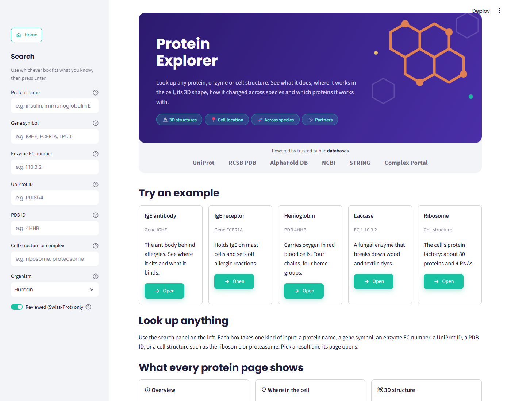
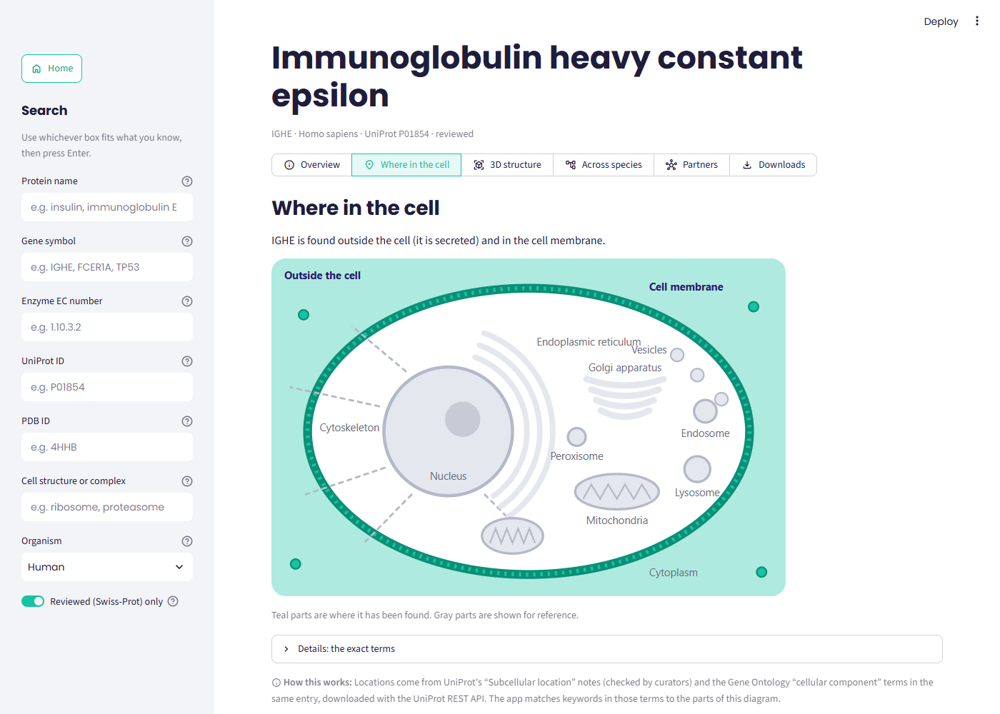
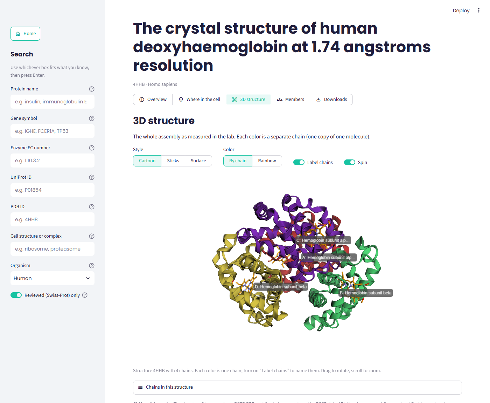
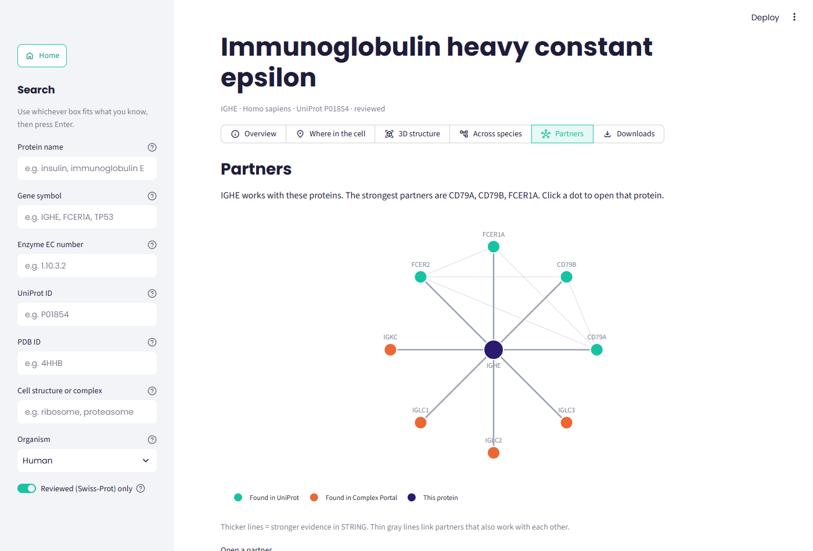
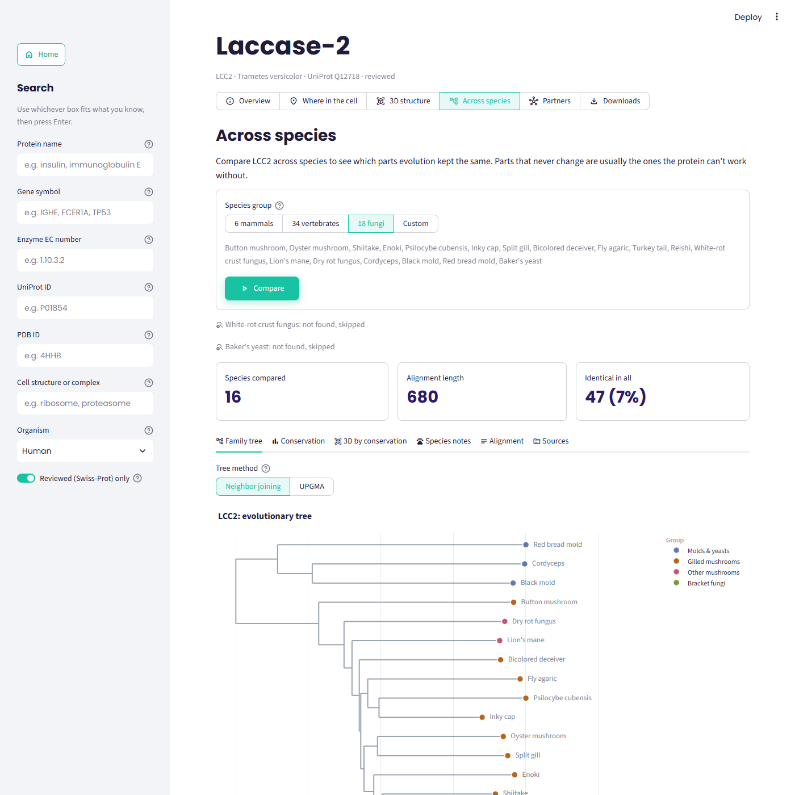
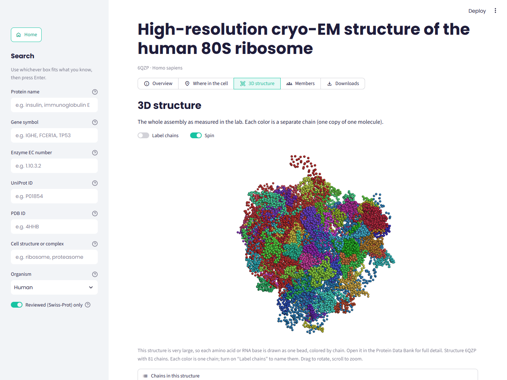

# 🧬 Protein Explorer

[](https://github.com/evanyoung1022-oss/Bio-Python-sequence-alignment/actions/workflows/tests.yml)
[](LICENSE)

**Live app: [hemoglobin-explorer.streamlit.app](https://hemoglobin-explorer.streamlit.app/)**

Look up any protein, enzyme or cell structure and get one clear page about it: what it does, where it works in the cell, its 3D shape, how it changed across species, and which proteins it works with. Every section starts with a plain-English sentence, so it reads well for students and recruiters, and keeps the technical detail (and the data sources) one click away for researchers.

Built with Python, Biopython and Streamlit on top of six free public databases: UniProt, RCSB PDB, AlphaFold DB, NCBI, STRING and the EBI Complex Portal.



## Try it

The home page has five one-click examples:

| Example | Searched by | What it shows off |
|---|---|---|
| IgE antibody | Gene `IGHE` | Secreted *and* membrane-bound; partners include its receptor FCER1A |
| IgE receptor | Gene `FCER1A` | A cell-membrane receptor and its signaling partners |
| Hemoglobin | PDB `4HHB` | A four-chain lab structure with every chain labeled |
| Laccase | EC `1.10.3.2` | A wood-digesting fungal enzyme compared across 16 mushrooms and molds |
| Ribosome | Cell structure | The 81-chain human ribosome (PDB 6QZP) in 3D |

## Search: one box per kind of input

| Box | Example | Goes to |
|---|---|---|
| Protein name | `insulin`, `immunoglobulin E` | UniProt |
| Gene symbol | `IGHE`, `FCER1A`, `TP53` | UniProt |
| Enzyme EC number | `1.10.3.2` | UniProt |
| UniProt ID | `P01854` | Opens the protein directly |
| PDB ID | `4HHB` | Opens the structure directly |
| Cell structure or complex | `ribosome`, `proteasome` | Complex Portal and RCSB PDB |

Each box is a dropdown with suggestions (about 140 common genes, everyday protein names, 39 enzymes with their EC numbers, famous PDB structures, well-known UniProt IDs and cell structures), every one checked against the databases. Typing filters the list (type "insulin" in the gene box to find INS), and anything not on the list can still be typed and searched. An organism filter (human by default, or any organism) and a "Reviewed (Swiss-Prot) only" switch narrow the results. Every page has its own web address (like `?protein=P01854`), so it can be bookmarked or shared.

A **Dark mode** switch at the top of the sidebar repaints the whole app, including the charts and the 3D viewer.

## The protein page

| Section | What you get |
|---|---|
| **Overview** | A 2-3 sentence summary, then names, gene, organism, length, function, EC number, diseases and links to UniProt, PDB, AlphaFold and NCBI |
| **Where in the cell** | A cell diagram that lights up where the protein is found, from UniProt's location notes and Gene Ontology terms |
| **3D structure** | Lab structures sorted sharpest first, or the AlphaFold prediction, with active and binding sites marked. Whole complexes are shown with every chain colored and labeled |
| **Across species** | Finds the same protein in 6 mammals, 34 vertebrates, 18 fungi or your own list, aligns them, and shows a family tree, a conservation chart, the alignment, a 3D model colored by conservation, species notes and sources |
| **Partners** | A clickable network of the proteins it works with; click a dot to open that protein |
| **Downloads** | FASTA, AlphaFold and lab structure files, the alignment, conservation scores (CSV), the tree (Newick) and chart pictures (PNG) |

Structures and complexes (a PDB ID, or a curated complex like the 26S proteasome) get a similar page with Overview, Where in the cell, 3D structure, Members and Downloads.

| | |
|---|---|
|  |  |
|  |  |



## How it works

```
Search box ──> UniProt / RCSB PDB / Complex Portal ──> protein page
                                                      ├─ Overview, cell location  (UniProt)
                                                      ├─ 3D structure             (RCSB PDB, AlphaFold DB → py3Dmol)
                                                      ├─ Across species           (NCBI via Bio.Entrez + UniProt → FAMSA → Bio.Phylo)
                                                      └─ Partners                 (STRING + UniProt + Complex Portal)
```

- **Finding the same protein in other species:** for vertebrates, Biopython's `Bio.Entrez` searches NCBI RefSeq by gene name, then NCBI's ortholog lists (mouse hemoglobin beta is called `Hbb-bs`), then by protein name, with UniProt and GenBank as fallbacks. Fungi are searched in UniProt first; because fungi often carry several copies of an enzyme, the app picks the copy most like a curator-reviewed one (using Biopython's `PairwiseAligner`).
- **Alignment and tree:** FAMSA (`pyfamsa`) aligns the sequences; each column is scored by how many species agree; Biopython's `DistanceCalculator` (BLOSUM62) and `DistanceTreeConstructor` build the tree.
- **3D:** structure files are read with a small mmCIF reader (so it also works where Windows blocks `Bio.PDB`'s compiled parts). UniProt's site positions are matched to each file's own residue numbers by sequence alignment. Giant assemblies like the ribosome (220,000 atoms) are reduced to one bead per residue so they load in a browser.
- **Partners:** STRING doesn't include antibody genes, so IgE's receptor would be missed by STRING alone. The app merges STRING with UniProt's interaction data, UniProt entries whose notes mention the protein (FCER1A's note says "Interacts with IGHE"), and fellow members of curated complexes.
- **Speed and reliability:** every database call is cached with `st.cache_data`, NCBI calls retry politely when NCBI is busy, and a slow or missing database shows a friendly message instead of breaking the page.

## Key findings (hemoglobin beta)

- **106 of 147 positions (72%) are identical** across human, chimpanzee, rhesus macaque, cow, pig and horse.
- **The most important sites never change.** Glu6 (mutated in sickle cell disease) and the two histidines that hold the heme iron (His63 and His92) are identical in all six species.
- **Human hemoglobin alpha and beta are about 42% identical.** The two chains came from one ancestral gene that was duplicated and then diverged.

## Project layout

| Path | What it does |
|---|---|
| `app.py` | Page layout only: the sidebar, and which page and section to show |
| `search.py` | The six search boxes, the organism filter and the results list |
| `suggestions.py` | The suggestion lists for the search dropdowns |
| `navigation.py` | Keeps the open page in the web address |
| `sources/` | One file per database: `uniprot.py`, `pdb.py`, `alphafold.py`, `ncbi.py`, `string_db.py`, `complex_portal.py`, plus `web.py` for downloads and friendly errors |
| `sections/` | One file per page section: `overview.py`, `location.py`, `structure.py`, `species.py`, `partners.py`, `downloads.py`, plus `complex.py` and `landing.py` |
| `orthologs.py` | Finds the same protein in other species |
| `analysis.py` | Alignment (FAMSA) and conservation scores |
| `tree.py` | Builds and draws the family tree |
| `viewer3d.py` | Draws 3D structures with py3Dmol and maps residue numbers |
| `charts.py` | Conservation chart and PNG pictures for downloads |
| `species_list.py`, `species_bios.py` | The 52 species with common names, groups and notes |
| `style.py`, `.streamlit/config.toml` | The purple and teal look, and the dark mode colors |
| `tests/` | 85 automated tests that run offline with canned database answers |
| `early_scripts/` | The first scripts from the original hemoglobin study |

## Run it on Windows

You need Python 3.11 or newer.

```powershell
git clone https://github.com/evanyoung1022-oss/Bio-Python-sequence-alignment.git
cd Bio-Python-sequence-alignment
python -m venv .venv
.venv\Scripts\Activate.ps1
python -m pip install -r requirements.txt
python -m streamlit run app.py
```

The app opens at http://localhost:8501.

- If PowerShell says running scripts is disabled, run `Set-ExecutionPolicy -Scope CurrentUser RemoteSigned` once, or skip activation and use `.venv\Scripts\python.exe -m streamlit run app.py`.
- Windows Smart App Control can block the `streamlit.exe` launcher ("An Application Control policy has blocked this file"). Starting it with `python -m streamlit` as above avoids that. If it blocks `pyfamsa`, the app falls back to a slower Biopython alignment automatically.

**NCBI email.** NCBI asks every user of its API for an email address. Create `.streamlit/secrets.toml` (it is ignored by git, so it never gets uploaded) containing:

```toml
NCBI_EMAIL = "you@example.com"
# NCBI_API_KEY = "..."   # optional and free; makes species searches about 3x faster
```

On Streamlit Community Cloud, paste the same lines into the app's **Settings → Secrets**.

**Tests:**

```powershell
python -m pip install pytest
python -m pytest
```

The tests never touch the internet: `tests/fakes.py` stands in for every database. They cover query building, reading each database's answers, the cell-location mapping, partner merging, residue-number mapping, ortholog picking, alignment and tree building, and they click through every page and section of the running app. GitHub Actions runs them on every push.

## Limitations

- Results depend on how well each species is annotated. Antibody genes like IGHE are sparsely annotated outside humans and mice, so fewer species are found for them.
- When a species has several versions (isoforms) of a protein, the first one NCBI returns is used.
- The cell diagram matches keywords in location terms, so it shows broad compartments, not exact sub-structures.
- AlphaFold structures are predictions; regions it isn't confident about often look like loose loops.
- A gene tree shows the history of one protein, which doesn't always match the history of the species.

## Built with

Python, Biopython (Entrez, SeqIO, PairwiseAligner, Phylo), Streamlit, FAMSA (pyfamsa), py3Dmol, Plotly, matplotlib, UniProt REST API, RCSB PDB search and data APIs, AlphaFold DB API, NCBI E-utilities, STRING API, EBI Complex Portal API, pytest, GitHub Actions.

## About

Built by Evan Young, studying Integrated Science and Technology (biotechnology) at James Madison University. Released under the [MIT License](LICENSE).
